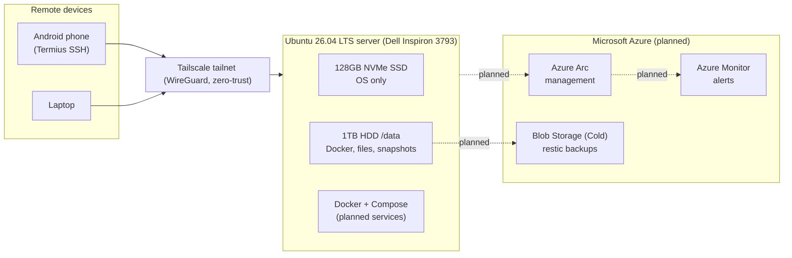

# Hybrid Home Lab: Ubuntu Server with Zero-Trust Access and Azure Integration

Turning a spare Dell laptop into a secure, remotely managed Linux server — and the foundation for a hybrid on-prem + Azure environment.

**Status:** 🟢 Phases 0–2 complete · 🟡 Phase 3–4 (services) next

---

## Why this project

I'm moving into Azure and Microsoft Fabric data engineering. Cloud platforms are only half the picture: real organisations run hybrid estates, with on-prem servers that need to be secured, monitored and backed up alongside cloud resources.

This lab is where I practise that end to end — Linux administration, networking, security, containers, backups and Azure hybrid management — on real hardware, with real problems to solve.

## Architecture

No ports are open on the home router. All access goes through Tailscale's encrypted mesh network.

## Hardware

| Component | Detail | Role |
| --- | --- | --- |
| Machine | Dell Inspiron 3793 (10th-gen Intel) | Server |
| RAM | 8GB DDR4 (1 of 2 slots used) | Upgrade to 16GB planned |
| SSD | 128GB NVMe | Ubuntu OS only |
| HDD | 1TB 2.5" SATA, mounted at `/data` | Docker data, files, Timeshift snapshots |
| OS | Ubuntu 26.04 LTS + Ubuntu Pro (ESM) | |

## Roadmap

| Phase | Goal | Status |
| --- | --- | --- |
| 0 | Prepare hardware for 24/7 running | ✅ Done |
| 1 | Secure remote access (SSH + Tailscale) | ✅ Done |
| 2 | Hardening (SSH keys, firewall, fail2ban, auto-updates) | 🟡 Next |
| 3 | Docker platform on `/data` | 🟡 Partly done |
| 4 | Services (Samba, Syncthing, Immich) | ⬜ Planned |
| 5 | 3-2-1 backups with restic to Azure Blob (Cold tier) | ⬜ Planned |
| 6 | Azure Arc onboarding + Azure Monitor alerts | ⬜ Planned |

---

## Phase 0 — Hardware preparation ✅

**Goal:** make an old laptop safe and reliable as an always-on server.

- **Drive health check.** Ran a full SMART assessment (`smartctl`) on the 1TB HDD, including a 4-hour extended surface scan. Result: no reallocated, pending or uncorrectable sectors. Identified attributes to monitor over time (load cycles, shock events, multi-zone errors).
- **Reduced drive wear.** The HDD was parking its heads ~34 times per hour. Adjusted Advanced Power Management, cutting head parks from ~800/day to under 15/day.
- **Freed the OS drive from 87% to 26% full.** Diagnosed with `du`, moved bulky user data to the HDD with `rsync` and symlinks (so application paths kept working), removed old snap revisions and set retention to 2.
- **Removed unneeded software,** including an unofficial third-party app package identified by checking its publisher and running process path.
- **Server behaviour.** Disabled sleep/suspend, kept the server running with the lid closed, and confirmed it recovers automatically after a reboot.
- **Security patching.** Enabled Ubuntu Pro (ESM) for extended security updates.

## Phase 1 — Secure remote access ✅

**Goal:** manage the server from anywhere without exposing it to the internet.

- Installed OpenSSH server and Tailscale (WireGuard-based mesh VPN).
- **Zero-trust networking:** no router port forwarding — the server is only reachable by authenticated devices on the private tailnet.
- Enabled MagicDNS so the server is reachable by name, not IP.
- Disabled key expiry for the server node so it never drops off the network unattended.
- Verified the SSH host key fingerprint on first connection.
- **Tested from a phone on 5G mobile data** with Wi-Fi off, including after a full reboot.

## Phase 2 — Hardening 🟢

- **SSH key authentication** (ED25519 key generated on the phone in Termius); password and root logins disabled via a drop-in file in `/etc/ssh/sshd_config.d/`, verified with `sshd -T`.
- **Firewall (`ufw`):** default deny incoming; only traffic on the `tailscale0` interface is allowed in, so the server is invisible to the local network and the internet.
- **`fail2ban`** watching the SSH journal for brute-force attempts.
- **Unattended security upgrades** enabled, with daily `apt` timers confirmed.
- Changes made in a safe order (key login proven before passwords were disabled) with a second session open as a fallback.

## Phase 3 — Docker platform 🟡

- Docker Engine and Compose installed, with the data root on the HDD (`/data/docker`) so container images never fill the OS drive.

_Planned: one folder per service, Compose files version-controlled._

## Phase 4 — Services ⬜

_Planned: Samba file share, Syncthing folder sync, Immich photo library (after RAM upgrade)._

## Phase 5 — Backups ⬜

_Planned: restic encrypted, deduplicated backups to Azure Blob Storage (Cold tier), following the 3-2-1 rule, with tested restores and an Azure budget alert._

## Phase 6 — Azure hybrid management ⬜

_Planned: onboard the server to Azure Arc, Azure Monitor alerts for CPU, memory and disk, and a write-up of costs._

---

## Problems solved

**1. OS drive nearly full (87%)**
The 128GB SSD had only 15GB free, which would have blocked Docker. Traced the space to user media and installer files, then moved data to the HDD with `rsync`, verified sizes, and replaced the folders with symlinks so nothing broke. Result: 26% used, 82GB free.

**2. Identity provider conflict in Tailscale**
I wanted to move the tailnet from a Google login to a Microsoft login (to align with Azure / Entra ID for future business use). Because the same email address was registered with both providers, Tailscale kept routing sign-in back to Google. Fixed by deleting the original tailnet, signing up fresh via the Microsoft provider, and re-authenticating the server node with `tailscale up --force-reauth`. Verified the migration using the admin console's configuration audit logs.

**3. Reboot blocked by active sessions**
`sudo reboot` was refused because I was logged in both locally and over SSH. Learned how systemd inhibitors work and when it's appropriate to override them.

**4. Verifying software provenance**
Found two desktop packages for the same app. Checked `apt policy` and running process paths to confirm which was the official signed build and which was an unofficial third-party snap, then removed the unofficial one.

**5. Excessive hard drive head parking**
SMART showed about 34 load/unload cycles an hour, wearing the drive needlessly. Set Advanced Power Management to 254 and disabled standby, then verified: only 4 head parks in the following 45 hours (versus ~1,500 before), with the error counters stable.

**5. Excessive hard drive head parking**
SMART showed about 34 load/unload cycles an hour, wearing the drive needlessly. Set Advanced Power Management to 254 and disabled standby, then verified: only 4 head parks in the following 45 hours (versus ~1,500 before), with the error counters stable.

## Skills demonstrated

Linux administration (Ubuntu) · server hardening (SSH keys, ufw, fail2ban) · server hardening (SSH keys, ufw, fail2ban) · storage diagnostics (SMART) · disk management · zero-trust networking (Tailscale / WireGuard) · SSH · package and patch management · Docker · troubleshooting and documentation · Azure (planned: Arc, Monitor, Blob Storage)

## What's next

- [x] Phase 2 hardening
- [ ] RAM upgrade to 16GB
- [ ] First services in Docker Compose
- [ ] Offsite backups to Azure
- [ ] Azure Arc onboarding
